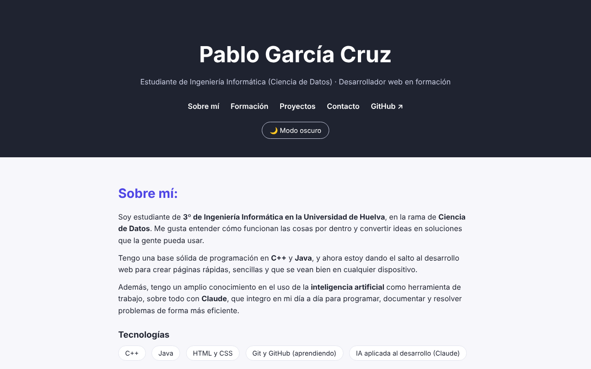

# Pablo García Cruz · Portfolio

👉 **Ver la web: [pablogarciacruz.pages.dev](https://pablogarciacruz.pages.dev)**

Mi portfolio personal: quién soy, mi formación y mis proyectos. Lo he diseñado y programado desde cero mientras aprendo desarrollo web.

## Qué incluye

- Presentación, formación e idiomas.
- Proyectos, con una demo interactiva de búsqueda de caminos (BFS y A*) de mis prácticas de Inteligencia Artificial.
- Modo claro y oscuro.
- Diseño adaptado a móvil.
- CV descargable en PDF.

## Tecnologías

HTML, CSS y JavaScript, sin frameworks. Publicada con Cloudflare Pages: cada `git push` a `main` actualiza la web automáticamente.

## Contacto

- Email: [pablogarcruz@gmail.com](mailto:pablogarcruz@gmail.com)
- GitHub: [PableitorAS](https://github.com/PableitorAS)
